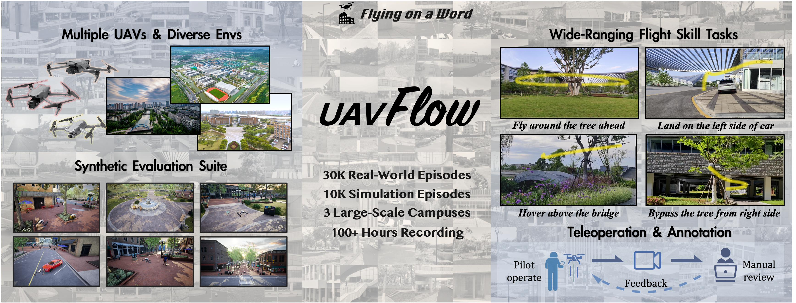

<div align="center">

<h1>UAV-Flow</h1>
<p><strong>Data, policies, and closed-loop evaluation for language-guided UAV control.</strong></p>

<p>
  <a href="https://arxiv.org/abs/2611.17163v1"></a>
  <a href="#original-paper"></a>
  <a href="https://huggingface.co/datasets/wangxiangyu0814/UAV-Flow"></a>
  <a href="https://huggingface.co/datasets/wangxiangyu0814/UAV-Flow-Sim"></a>
</p>

<p>
  <a href="#quick-start">🚀 Quick Start</a> &nbsp;｜&nbsp;
  <a href="#data-and-models">📦 Data &amp; Models</a> &nbsp;｜&nbsp;
  <a href="#documentation">📚 Documentation</a> &nbsp;｜&nbsp;
  <a href="#citation">📝 Citation</a>
</p>
</div>

## 📝 Introduction

UAV-Flow connects **real-world and simulated UAV data, policy training, and
closed-loop evaluation**. Train a policy with FlowVLA or OpenVLA-UAV, serve it
through HTTP, and evaluate its trajectories in the UnrealZoo-based simulator.

[UAV-Flow++](https://arxiv.org/abs/2611.17163v1) presents FlowVLA and Tail-Aware GRPO (TGRPO) for language-guided UAV flight.

<p align="center">
  
</p>

## ✨ Key Features

- **🛩️ Real and simulated flight data.** UAV-Flow and UAV-Flow-Sim provide RGB observations, language instructions, and flight trajectories.
- **🧠 UAV policy baselines.** FlowVLA supports discrete, continuous, and FAST action heads. OpenVLA-UAV provides the original finetuning baseline.
- **📊 Closed-loop evaluation.** Connect a model API, run simulator tasks, and collect trajectories, frames, action logs, success rates, and NDTW scores.
- **🔁 Simulator services for RL.** Launch and manage simulator services for an external RL trainer through the `uav-flow train-env` CLI.

<a id="quick-start"></a>

## 🚀 Quick Start

Use a separate Python environment for each component. The model server and
evaluator communicate through HTTP.

| Component | Python | Setup |
|---|---|---|
| FlowVLA | 3.12 | Linux, CUDA 12.6 |
| UAV-Flow-Eval | 3.11 | Linux x86_64, NVIDIA graphics and Vulkan |
| OpenVLA-UAV | 3.10 | [Installation guide](OpenVLA-UAV/README.md#installation) |

### Prepare the FlowVLA Model

#### Install FlowVLA

From the repository root:

```bash
cd flowVLA
conda create -n flowvla python=3.12 -y
conda activate flowvla
pip install -r requirements.txt
pip install -e .
cd ..
```

#### Prepare the Training Data

Download the Parquet release from [UAV-Flow (real-world flights)](https://huggingface.co/datasets/wangxiangyu0814/UAV-Flow) or [UAV-Flow-Sim (simulated flights)](https://huggingface.co/datasets/wangxiangyu0814/UAV-Flow-Sim).
For example, to prepare UAV-Flow-Sim, run from the repository root:

```bash
python -m pip install datasets Pillow tqdm
hf download wangxiangyu0814/UAV-Flow-Sim --repo-type dataset \
  --include "*.parquet" --local-dir /path/to/UAVFlow-parquet
```

The training loader reads episode folders. To convert the downloaded Parquet
files, set the two paths at the bottom of
[`dataset_tools/prepare_data.py`](dataset_tools/prepare_data.py):

```python
parquet_dir = '/path/to/UAVFlow-parquet'  # Downloaded .parquet files.
train_dir = '/path/to/UAVFlow'           # Output episode folders.
```

Then run the converter from the repository root:

```bash
python dataset_tools/prepare_data.py
```

The converter groups frames by episode ID, saves them as numbered JPEG files,
and writes the trajectory logs and language instructions to `log.json`:

```text
/path/to/UAVFlow/
├── episode_id_1/
│   ├── 000000.jpg
│   ├── 000001.jpg
│   ├── ...
│   └── log.json
└── episode_id_2/
    ├── ...
    └── log.json
```

#### Train a FlowVLA Policy

See the [FlowVLA README](flowVLA/README.md) for detailed configuration, training,
and inference instructions.

```bash
cd flowVLA # From the repository root, in the FlowVLA environment.

hf download Qwen/Qwen3-VL-2B-Instruct \
  --local-dir /path/to/models/Qwen3-VL-2B-Instruct

BASE_VLM=/path/to/models/Qwen3-VL-2B-Instruct \
DATA_ROOT_DIR=/path/to/UAVFlow \
RUN_ROOT_DIR=./results RUN_ID=flowvla \
bash scripts/run_scripts/uav_train_qwen3vl_discrete.sh
```

#### Launch the Inference Server

In the FlowVLA environment, run from `flowVLA/`. Set `RUN_DIR` to the saved training run containing the model weights and `config.yaml`:

```bash
RUN_DIR=./results/flowvla \
STATS_PATH=/path/to/statistics.json \
CUDA_VISIBLE_DEVICES=0 HTTP_PORT=6070 \
bash scripts/run_scripts/start_qwen3vl_discrete_server.sh
```

`STATS_PATH` selects the statistics JSON matching the checkpoint's training
normalization. Each run saves its statistics alongside its configuration.
Other action heads use their [matching server scripts](flowVLA/README.md#3-inference).

> **OpenVLA-UAV:** start its [UAV server](OpenVLA-UAV/README.md#inference--evaluation)
> in the OpenVLA environment, then pass that server's URL to the evaluator.
> It uses the checkpoint's `norm_stats`, selected by `--unnorm-key sim`.

### Run Closed-Loop Evaluation

See the [UAV-Flow-Eval README](UAV-Flow-Eval/README.md) for detailed simulator
setup, evaluation configuration, and execution instructions.

For a full simulation, download the [Linux UE scene package](#data-and-models).
In another terminal, start from the repository root:

```bash
cd UAV-Flow-Eval
python3.11 -m venv .venv
source .venv/bin/activate
python -m pip install 'pip==24.0' 'setuptools==79.0.1' 'wheel==0.48.0'
python -m pip install .
cp configs/example.toml configs/local.evaluation.toml
```

Edit the
`[evaluation]` section of `configs/local.evaluation.toml`:

- `server_url`: the running model API; use `http://127.0.0.1:6070` for the server above.
- `ue_package`: the extracted scene directory containing `Collection/` and `Engine/`.
- `graphics_adapter`: the Vulkan adapter index.
- `output`: a fresh directory for this run.

Paths are relative to the TOML file. When launching as root, set `ue_user` to an
ordinary account with access to the Python environment, scene package, and output.

```bash
uav-flow evaluate --settings configs/local.evaluation.toml --model-name flowvla
```

The evaluator writes trajectories, frames, and action logs under the output
directory, with overall and task-category scores in `metrics.json`.

<details>
<summary><strong>🔁 Launch simulator services for RL training</strong></summary>

In the evaluation environment, run from `UAV-Flow-Eval/`:

```bash
cp configs/example.toml configs/local.training.toml
# Set training.package, output, gpus, ports, and user.
uav-flow train-env start --settings configs/local.training.toml
```

Use `uav-flow train-env --help` for status and stop commands. The RL trainer is
supplied separately.

</details>

<a id="data-and-models"></a>

## 📦 Data & Models

| Resource | Download |
|---|---|
| UAV-Flow real-world trajectories | [Hugging Face](https://huggingface.co/datasets/wangxiangyu0814/UAV-Flow) |
| UAV-Flow-Sim simulation trajectories | [Hugging Face](https://huggingface.co/datasets/wangxiangyu0814/UAV-Flow-Sim) |
| OpenVLA-UAV checkpoint | [Hugging Face](https://huggingface.co/wangxiangyu0814/OpenVLA-UAV) |
| FlowVLA `qwen3vl_discrete`, 80k steps | [Hugging Face](https://huggingface.co/datasets/wangxiangyu0814/UAV-Flow-flowVLA/blob/main/flowvla_pretrain_mixdata_dis_head.pth) |
| FlowVLA `qwen3vl_discrete` + TGRPO | [Hugging Face](https://huggingface.co/datasets/wangxiangyu0814/UAV-Flow-flowVLA/blob/main/flowvla_tgrpo_mixdata_dis_head.pth) |
| Flow-Sim Simulator Linux package | [Hugging Face](https://huggingface.co/datasets/wangxiangyu0814/UAV-Flow-Sim-Env/blob/main/Collection_v4_LinuxNoEditor.tar.gz) |

For download commands, Parquet conversion, and the expected episode layout, see
[Prepare the Training Data](#prepare-the-training-data).

<a id="documentation"></a>

## 📚 Documentation

| Guide | What's inside |
|---|---|
| [🧠 FlowVLA](flowVLA/README.md) | Installation, training recipes, normalization statistics, checkpoints, and inference servers |
| [🛩️ OpenVLA-UAV](OpenVLA-UAV/README.md) | Original baseline installation, finetuning, and UAV inference |
| [📊 UAV-Flow-Eval](UAV-Flow-Eval/README.md) | Linux simulator setup, closed-loop evaluation, scoring, and training environment services |
| [📦 Dataset tools](dataset_tools/README.md) | Parquet-to-episode conversion |

## 🗺️ TODO

- [ ] Release the RL training framework.

<a id="citation"></a>

## 📝 Citation

If you use UAV-Flow datasets, models, or evaluation tools in your research,
please consider citing the following papers.

### UAV-Flow++ Report [arxiv](https://arxiv.org/abs/2611.17163v1)

```bibtex
@misc{yang2026uavflowpp,
  title={{UAV-Flow++}: A Unified Suite for Benchmarking and Learning Language-Guided UAV Flight},
  author={Yang, Donglin and Wang, Xiangyu and Zhong, Yantong and Zheng, Wenhao and Ding, Zihan and Liao, Yue and Li, Hongsheng and Xu, Ke and Liu, Si},
  year={2026},
  eprint={2611.17163},
  archivePrefix={arXiv},
  primaryClass={cs.RO},
  url={https://arxiv.org/abs/2611.17163}
}
```

<a id="original-paper"></a>

### UAV-Flow Colosseo · NeurIPS 2025

```bibtex
@article{wang2026uav,
  title={Uav-flow colosseo: A real-world benchmark for flying-on-a-word uav imitation learning},
  author={Wang, Xiangyu and Yang, Donglin and Liao, Yue and Zheng, Wenhao and Dai, Bin and Li, Hongsheng and Liu, Si and others},
  journal={Advances in Neural Information Processing Systems},
  volume={38},
  year={2026}
}
```

## ⚖️ License & Acknowledgements

Project-authored code uses [Apache-2.0](LICENSE). Project-authored datasets,
images, and documentation use [CC BY-NC 4.0](LICENSE-CONTENT).
See [licensing scope](LICENSING.md) for details and exceptions.

We build on [OpenVLA](https://github.com/openvla/openvla),
[StarVLA](https://github.com/starVLA/starVLA), and
[UnrealZoo Gym](https://github.com/UnrealZoo/unrealzoo-gym). We thank their
maintainers for sharing code, models, and simulation resources.
